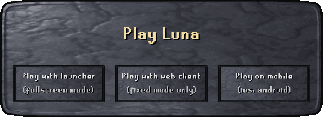

# Luna |   
Luna is a permanent revision 377 RuneScape server where everyone is welcome to play and progress.
Enjoy faithful classic gameplay with limited changes, in a living world where autonomous player bots
train, trade, fight, and progress alongside you.

<a href="https://github.com/luna-rs/luna-client/releases/download/v0.5.0-alpha/luna-launcher.exe">Play with launcher</a> · <a href="https://luna-rs.github.io/luna-client/">Play with web client</a> · <a href="https://luna-rs.github.io/luna-client/mobile/?mobile=1">Play on mobile (web beta)</a>

- 5× XP
- Standard economy with restricted item spawning
- No character wipes

Luna is actively developed. Your feedback and bug reports help improve the world as you play.
Luna preserves the classic experience; **HiveScape** will be the home for our custom content and “what if?” ideas.

### Play on mobile

[Open Luna Mobile](https://luna-rs.github.io/luna-client/mobile/?mobile=1) on your phone for the touch-enabled web beta.
Rotate to landscape, tap **Play**, and use the existing Luna login screen.

On iPhone, open the link in Safari, choose **Share → Add to Home Screen**, and add the icon.
Launch that icon to return to Luna Mobile. No app download is needed; an internet connection is required.

# Meet the bots

- **Real progression**: Bots train skills, acquire gear, build wealth, and progress from level 3 to 126.
- **Dynamic behavior**: Bots make their own decisions based on their personalities, goals, resources, and experiences.
- **Player-like activities**: Bots skill, PvM, PK, trade, socialize, loot, and scam each other!

# Create your own world

To get started, visit the [wiki](https://github.com/luna-rs/luna/wiki) and follow the setup instructions.

# Follow our development

- [Benchmarks](https://github.com/luna-rs/luna/tree/master/data/benchmarks) 
- [Follow updates, get help, or contribute (Discord)](https://discord.gg/bqkGY7cmVX)

<!--# Support us

[donation link here]-->

# Thanks
- blakeman8192 
- Graham
- [Apollo](https://github.com/apollo-rsps/apollo) development team
- [Lost City RS](https://github.com/LostCityRS/Content/tree/377-wip) development team
- [RS Mod](https://github.com/rsmod/rsmod) development team, whose routefinder our pathfinding is based on
- All [developers](https://github.com/orgs/luna-rs/people), [contributors](https://github.com/luna-rs/luna/graphs/contributors) and supporters of the project. 