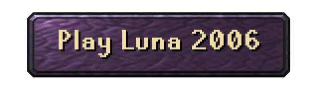
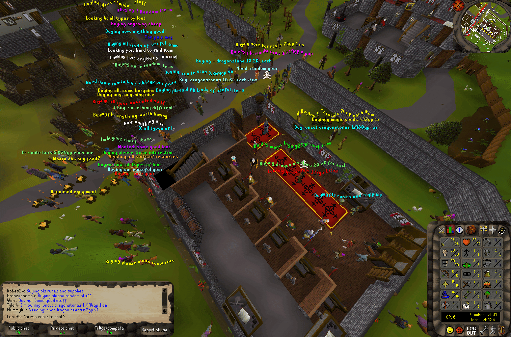

# Luna |   
Luna is a high-performance RuneScape server for the #377 protocol. It combines classic 2006-style gameplay 
with **autonomous player bots** that train, trade, fight, and progress alongside you.

**Luna 2006** is an actively hosted 2006-era experience based on this project. Come see the 
gameplay for yourself!

- 5x experience for players, 1x experience for bots
- No character/economy wipes or resets

# Meet the bots

- **Real progression**: Bots train skills, acquire gear, build wealth, and progress from level 3 to 126.
- **Dynamic behavior**: Bots make their own decisions based on their personalities, goals, resources, and experiences.
- **Player-like activities**: Bots skill, PvM, PK, trade, socialize, loot, and scam each other!

# Create your own world

To get started, visit the [wiki](https://github.com/luna-rs/luna/wiki) and follow the setup instructions.

# Follow our development

- [Benchmarks](https://github.com/luna-rs/luna/tree/master/data/benchmarks) 
- [Join the Discord](https://discord.gg/cpqFaHMdv9)

# Support our development

# Thanks
- blakeman8192 
- Graham
- [Apollo](https://github.com/apollo-rsps/apollo) development team
- [Lost City RS](https://github.com/LostCityRS/Content/tree/377-wip) development team
- [RS Mod](https://github.com/rsmod/rsmod) development team, whose routefinder our pathfinding is based on
- All [developers](https://github.com/orgs/luna-rs/people), [contributors](https://github.com/luna-rs/luna/graphs/contributors) and supporters of the project