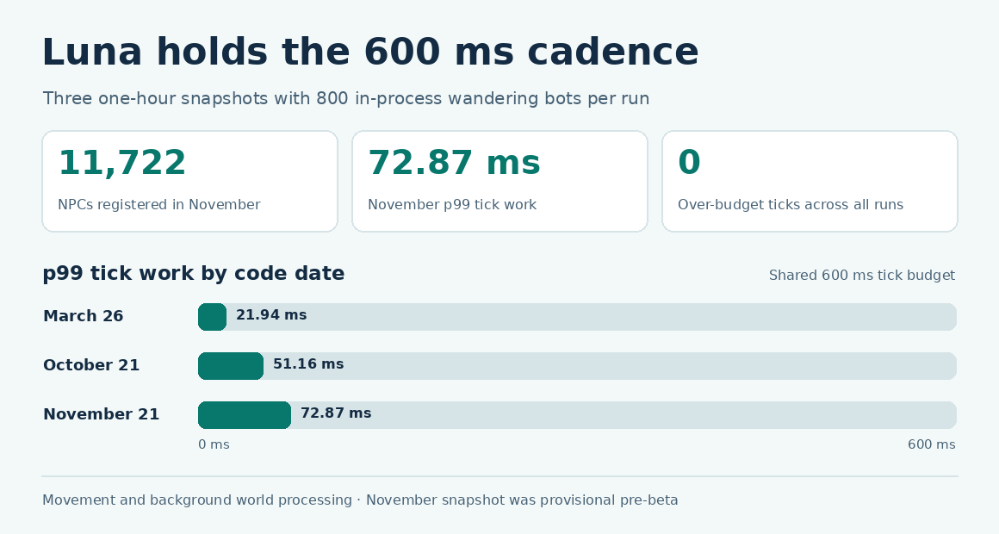

# Luna |   
Luna is a high-performance RuneScape server for the #377 protocol. It combines classic 2006-style gameplay 
with **autonomous player bots** that train, trade, fight, and progress alongside you.

**Luna 2006** is a free-to-play actively hosted 2006-era experience based on this project. Come see the
gameplay for yourself!

- 5x experience for players, 1x experience for bots
- Standard economy, no item spawns
- No character/economy wipes or resets

# Meet the bots

- **Real progression**: Bots train skills, acquire gear, build wealth, and progress from level 3 to 126.
- **Dynamic behavior**: Bots make their own decisions based on their personalities, goals, resources, and experiences.
- **Player-like activities**: Bots skill, PvM, PK, trade, socialize, loot, and scam each other!

# Create your own world

To get started, visit the [wiki](https://github.com/luna-rs/luna/wiki) and follow the setup instructions.

Use JDK 21 and the included Gradle wrapper to run the server (`./gradlew run` on Linux/macOS or
`.\gradlew.bat run` on Windows). The server reads its settings from `data/luna.jsonc`.

Before hosting publicly, generate a fresh RSA key pair with [rsakeygen](https://github.com/luna-rs/rsakeygen).
Keep `data/net/rsa/rsapriv.json` private on the server and configure the client with the matching
`rsapub.json` values. The server reads its key at startup.

MySQL persistence is optional. Create a database user, import [the schema](data/net/sql/luna.sql), then set the
connection details under `database` and set `game.serializer` to `SqlGameSerializer` in `data/luna.jsonc`.
The schema stores player and bot accounts, skills, economy prices, and price history. If you use the optional
[`user.sql` helper](data/net/sql/user.sql), set your own password before running it and use the same password
in the server configuration.

## Working on Luna

| Path | What belongs there |
| --- | --- |
| `src/main/java/io/luna` | Core runtime, game models, networking, and persistence |
| `src/main/kotlin/api` | Scripting DSLs, event registration, and helpers shared with the Java runtime |
| `src/main/kotlin/engine` | Core gameplay listeners for spawning, banking, trading, interfaces, and following |
| `src/main/kotlin/game` | World content, skills, teleports, consumables, minigames, and bot scripts |
| `data/dumps` | Reference JSON exported from the revision 377 cache. Regenerate it in-game with `::dump` or with `CacheDumpUtils.dump()`. |

## Benchmarked performance

Three one-hour runs each sustained **800 in-process wandering bots** with ordinary background world processing.
All three recorded zero ticks over the 600 ms processing budget and zero scheduling gaps over 900 ms. The
November snapshot recorded **72.87 ms p99 tick processing with 11,722 registered NPCs**.

| Code snapshot | Registered NPCs | Mean tick work | p99 tick work | Mean CPU | Mean resident memory | Evidence |
| --- | ---: | ---: | ---: | ---: | ---: | --- |
| Mar 26, 2026 · `c9552bea` | 52 | 7.31 ms | 21.94 ms | 194.07% | 5.76 GiB | [Run files](data/benchmarks/benchmark-2026-03-26-run-20261122T030608176775Z/) |
| Oct 21, 2026 · `a928f437` | 11,674 | 30.97 ms | 51.16 ms | 6.68% | 4.50 GiB | [Run files](data/benchmarks/benchmark-2026-10-21/) |
| Nov 21, 2026 · `9cad662e` | 11,722 | 36.08 ms | 72.87 ms | 7.82% | 4.79 GiB | [Run files](data/benchmarks/benchmark-2026-11-21-run-20261121T235914749522Z/) |

CPU is reported as a percentage of one core. The runs used a four-core, 16 GiB allocation. March used Java 11,
and October and November used Java 21. Between October and November, mean tick work rose by 5.11 ms and p99 rose
by 21.70 ms. November used about 12% of the tick budget at p99. The larger world included expanded Slayer
encounters, new shops and dialogue, and more elaborate bot behavior.
[Content and engine history](https://github.com/luna-rs/luna/compare/c9552bea...9cad662e)

November is a provisional pre-beta snapshot. [Final beta checklist](https://github.com/luna-rs/luna/issues/581)

Each run directory includes a source manifest, raw measurements, charts, and reproduction commands in
`reproduce.txt`. To start a fresh run in the benchmark environment, use
`python3 scripts/performance/run.py run current`. The harness uses the
[OpenRS2 revision 377 cache](https://archive.openrs2.org/caches/runescape/657) and the JDK and Gradle cache paths
recorded in the manifests. Pillow and DejaVu Sans are used to render the charts.

## Contributing

Open a [GitHub issue](https://github.com/luna-rs/luna/issues) before starting a fix or feature. Include
reproduction steps for bugs. For larger changes, outline the use case, approach, and test cases.

Keep commits focused and self-contained. Add `Issue: #123` on its own line in the commit message when it
applies. In your pull request, link the issue, describe what changed and why, and summarize verification.
Follow the surrounding code style, include `@author` tags on new Java and Kotlin classes, and keep unrelated
formatting edits out of the diff.

Ask questions in [Discord](https://discord.gg/cpqFaHMdv9) in `#dev-talk`.

# Support our development

# Thanks
- blakeman8192 
- Graham
- [Apollo](https://github.com/apollo-rsps/apollo) development team
- [Lost City RS](https://github.com/LostCityRS/Content/tree/377-wip) development team
- [RS Mod](https://github.com/rsmod/rsmod) development team, whose routefinder our pathfinding is based on
- All [developers](https://github.com/orgs/luna-rs/people), [contributors](https://github.com/luna-rs/luna/graphs/contributors) and supporters of the project
