# Benchmark gallery

[Benchmark overview](README.md) · [Run index](RUNS.md)

## 2024-05-12 · Initial bot framework introduction · BLOCKED

Commit `4d699a75` · Attempt `20261121T235036298246Z`

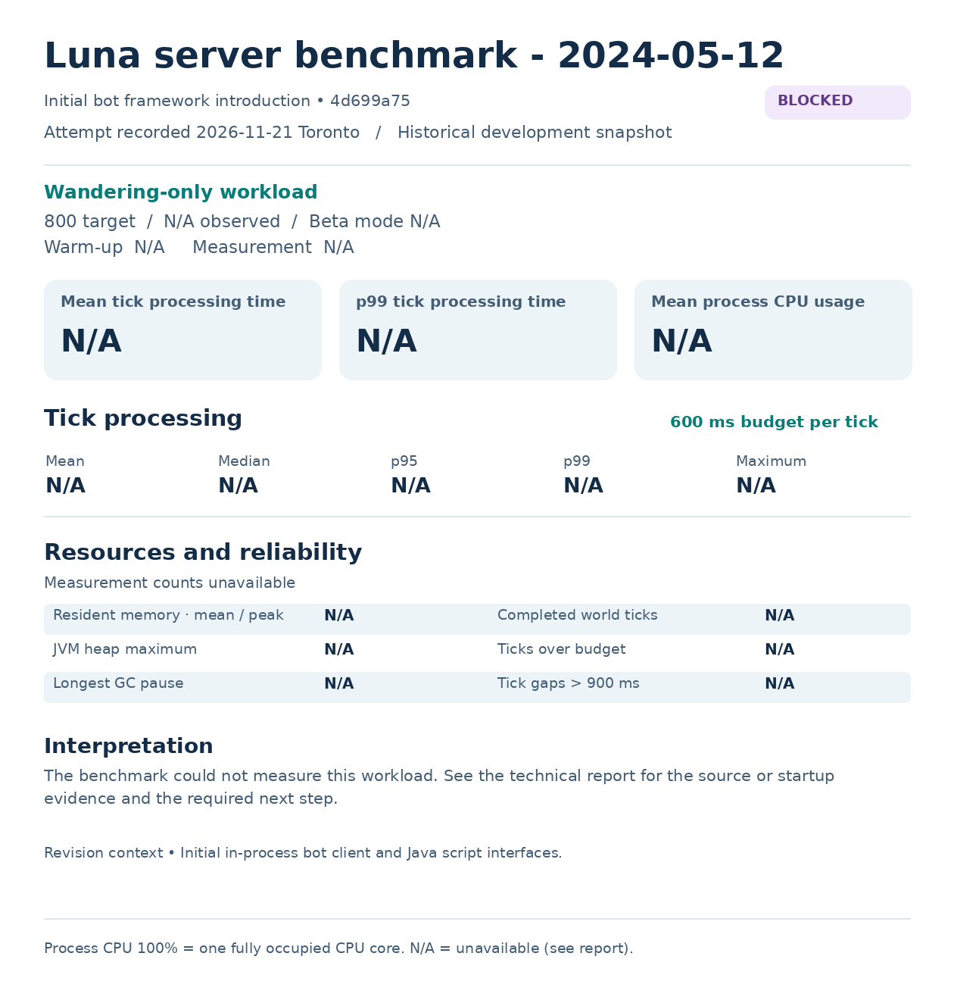

[Technical report](benchmark-2024-05-12/report.md) · [Manifest](benchmark-2024-05-12/manifest.json)

## 2024-12-30 · First bot scripts and first complete framework source · BLOCKED

Commit `2d197eb3` · Attempt `20261121T235037091540Z`

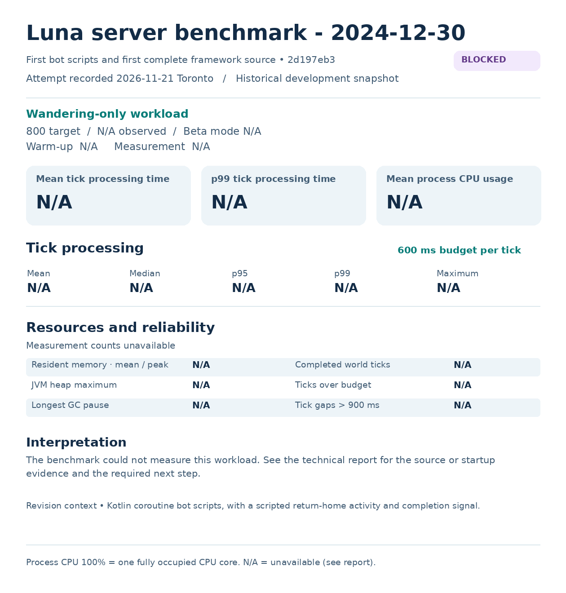

[Technical report](benchmark-2024-12-30/report.md) · [Manifest](benchmark-2024-12-30/manifest.json)

## 2025-01-03 · Early bot framework startup candidate · BLOCKED

Commit `246b88fd` · Attempt `20261122T042854240262Z`

[Technical report](benchmark-2025-01-03/report.md) · [Manifest](benchmark-2025-01-03/manifest.json)

## 2025-01-04 · Earliest verified runnable bot framework and scripts · BLOCKED

Commit `027b89ac` · Attempt `20261122T042854474899Z`

[Technical report](benchmark-2025-01-04/report.md) · [Manifest](benchmark-2025-01-04/manifest.json)

## 2025-01-26 · Early runnable bot framework and scripts · BLOCKED

Commit `0b3c6995` · Attempt `20261122T001156369267Z`

[Technical report](benchmark-2025-01-26/report.md) · [Manifest](benchmark-2025-01-26/manifest.json)

## 2025-01-26 · Early runnable bot framework and scripts · BLOCKED

Commit `0b3c6995` · Attempt `20261122T023841129502Z`

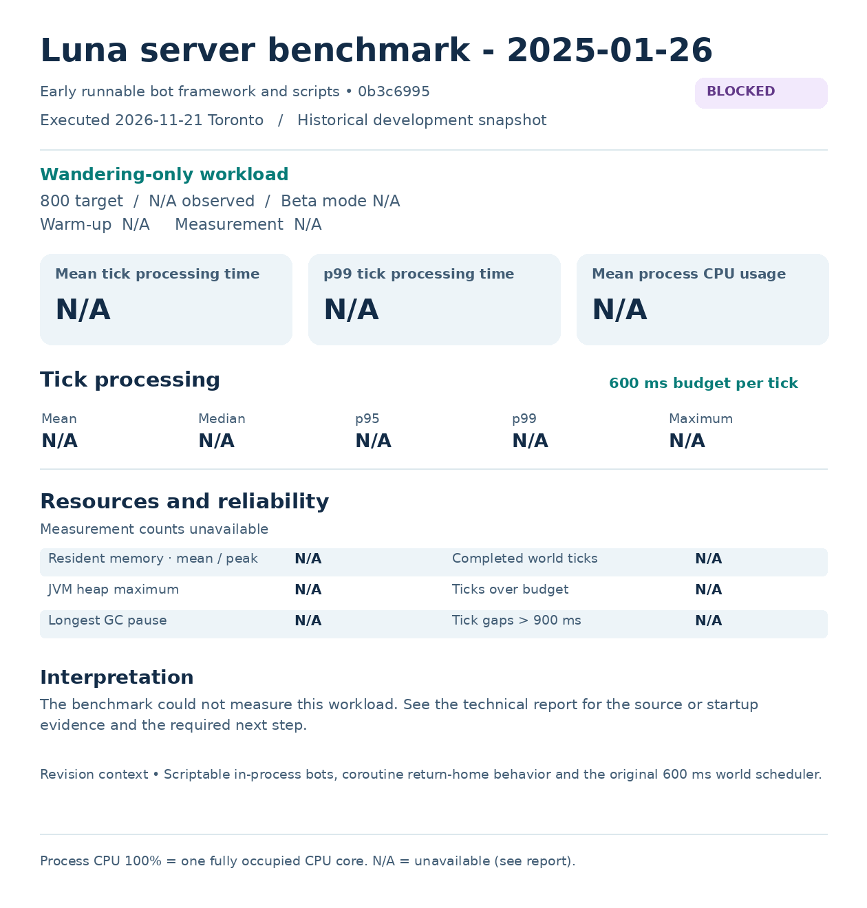

[Technical report](benchmark-2025-01-26-run-20261122T023841129502Z/report.md) · [Manifest](benchmark-2025-01-26-run-20261122T023841129502Z/manifest.json)

## 2025-12-16 · Native-wandering substitute for the early bot checkpoints · FAILED

Commit `bb69251d` · Attempt `20261122T023540625993Z`

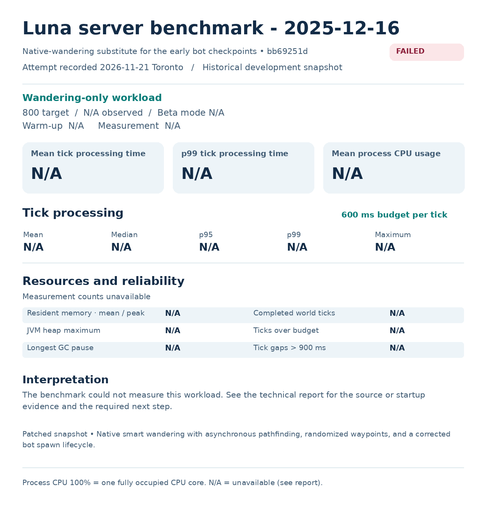

[Technical report](benchmark-2025-12-16/report.md) · [Manifest](benchmark-2025-12-16/manifest.json)

## 2026-03-26 · Native-wandering substitute for the early bot checkpoints · FAILED

Commit `c9552bea` · Attempt `20261122T023611958708Z`

[Technical report](benchmark-2026-03-26/report.md) · [Manifest](benchmark-2026-03-26/manifest.json)

## 2026-03-26 · Native-wandering substitute for the early bot checkpoints · FAILED

Commit `c9552bea` · Attempt `20261122T023923357724Z`

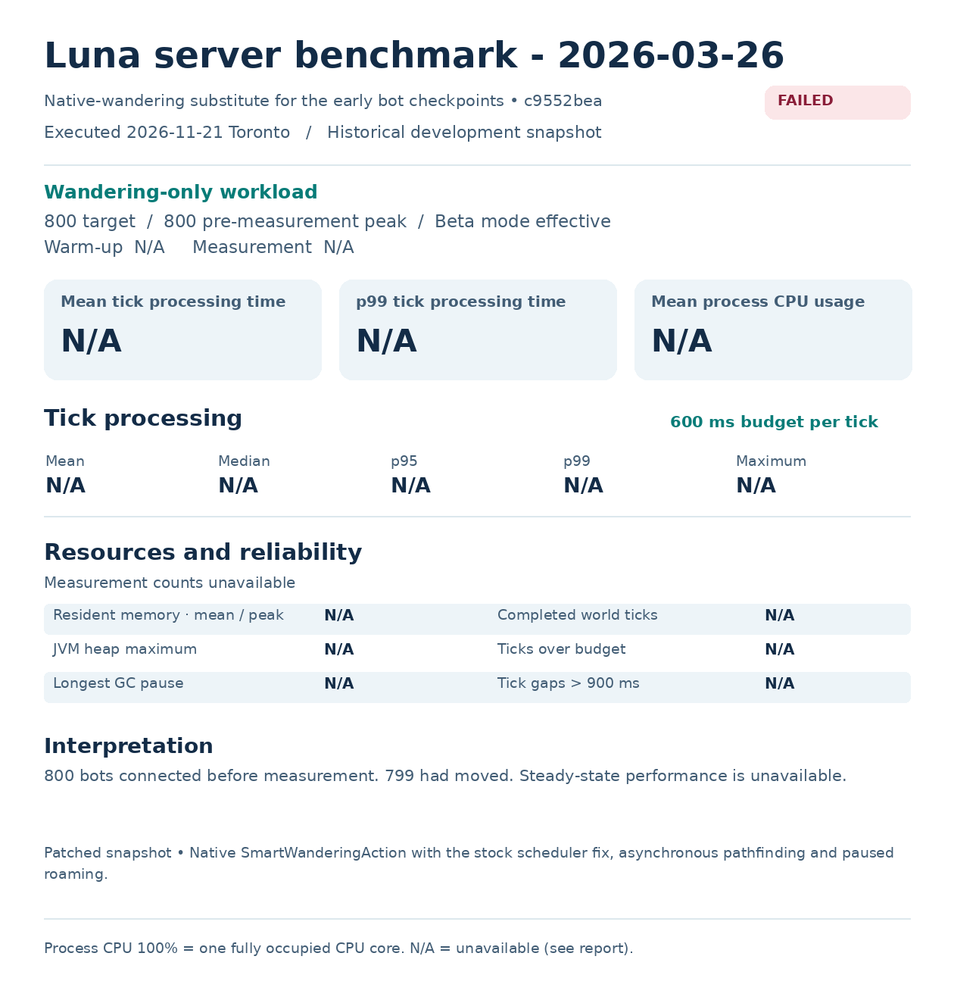

[Technical report](benchmark-2026-03-26-run-20261122T023923357724Z/report.md) · [Manifest](benchmark-2026-03-26-run-20261122T023923357724Z/manifest.json)

## 2026-03-26 · Native-wandering substitute for the early bot checkpoints · FAILED

Commit `c9552bea` · Attempt `20261122T025247301090Z`

[Technical report](benchmark-2026-03-26-run-20261122T025247301090Z/report.md) · [Manifest](benchmark-2026-03-26-run-20261122T025247301090Z/manifest.json)

## 2026-03-26 · Native-wandering substitute for the early bot checkpoints · COMPLETE

Commit `c9552bea` · Attempt `20261122T030608176775Z`

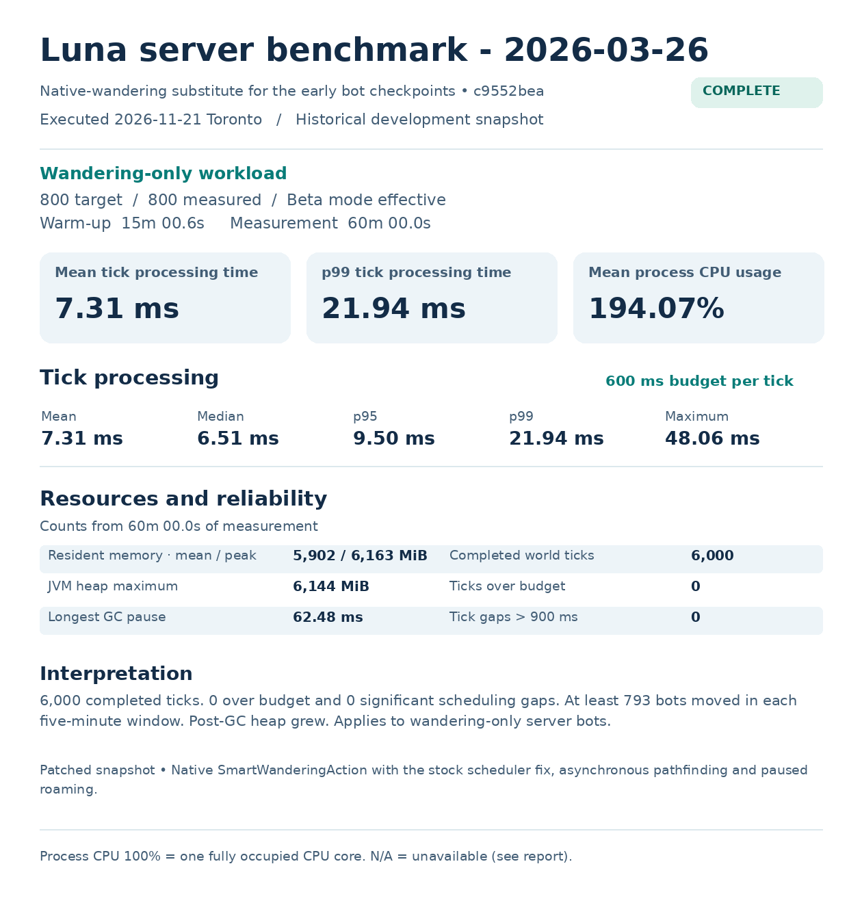

[Technical report](benchmark-2026-03-26-run-20261122T030608176775Z/report.md) · [Manifest](benchmark-2026-03-26-run-20261122T030608176775Z/manifest.json)

## 2026-10-21 · One calendar month before the task · COMPLETE

Commit `a928f437` · Attempt `20261122T011810162875Z`

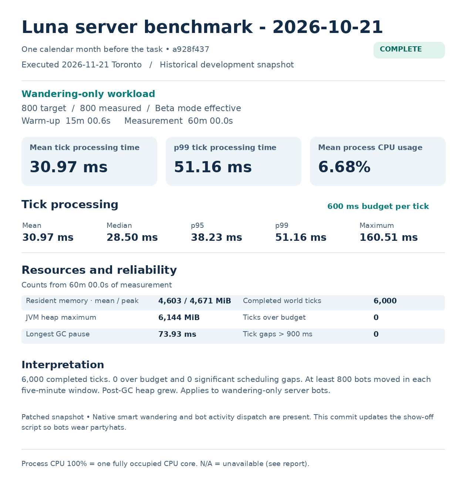

[Technical report](benchmark-2026-10-21/report.md) · [Manifest](benchmark-2026-10-21/manifest.json)

## 2026-11-21 · Current master · FAILED

Commit `9cad662e` · Attempt `20261121T234312642227Z`

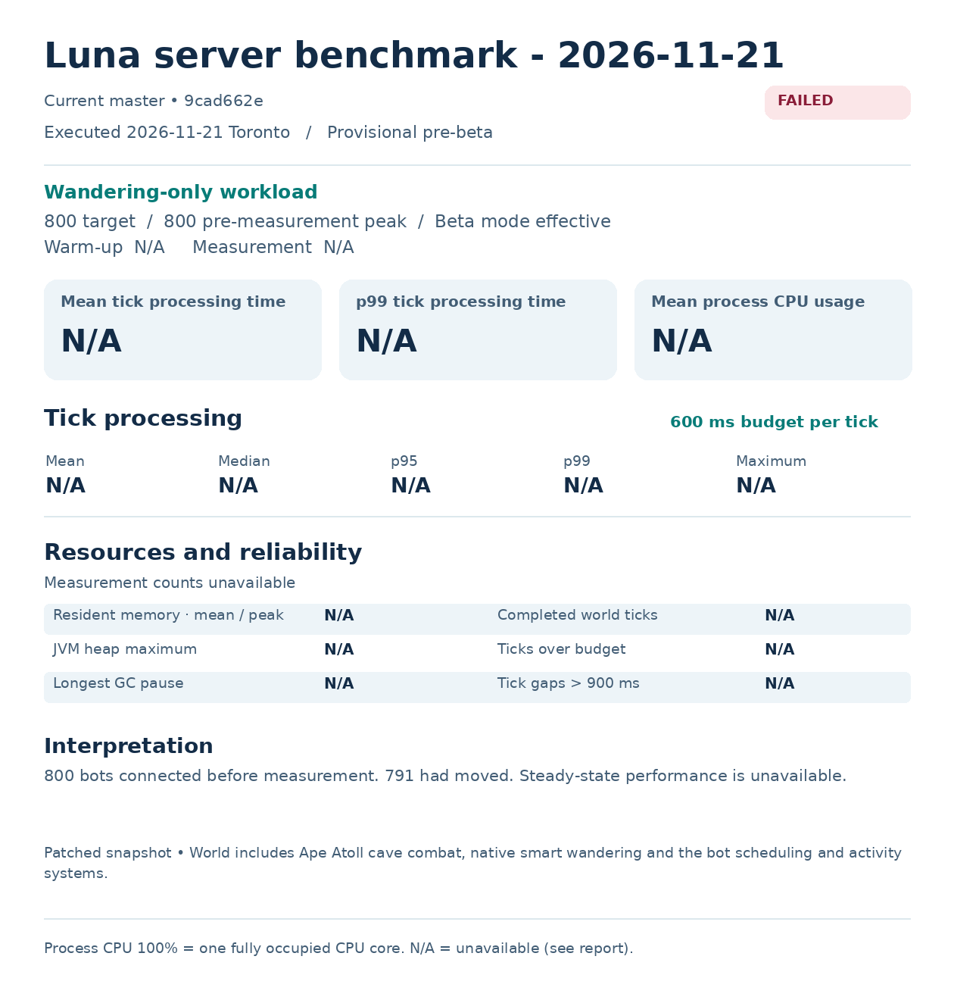

[Technical report](benchmark-2026-11-21/report.md) · [Manifest](benchmark-2026-11-21/manifest.json)

## 2026-11-21 · Current master · FAILED

Commit `9cad662e` · Attempt `20261121T235037771613Z`

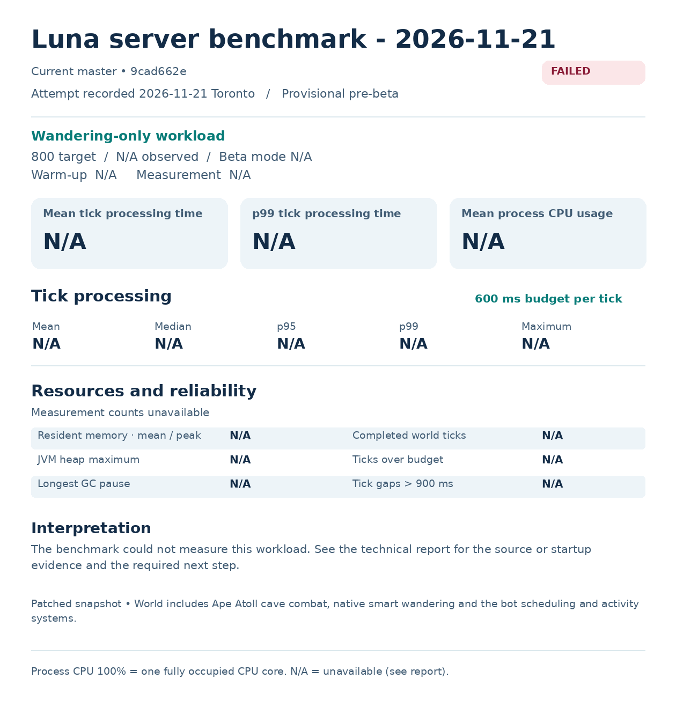

[Technical report](benchmark-2026-11-21-run-20261121T235037771613Z/report.md) · [Manifest](benchmark-2026-11-21-run-20261121T235037771613Z/manifest.json)

## 2026-11-21 · Current master · FAILED

Commit `9cad662e` · Attempt `20261121T235521849932Z`

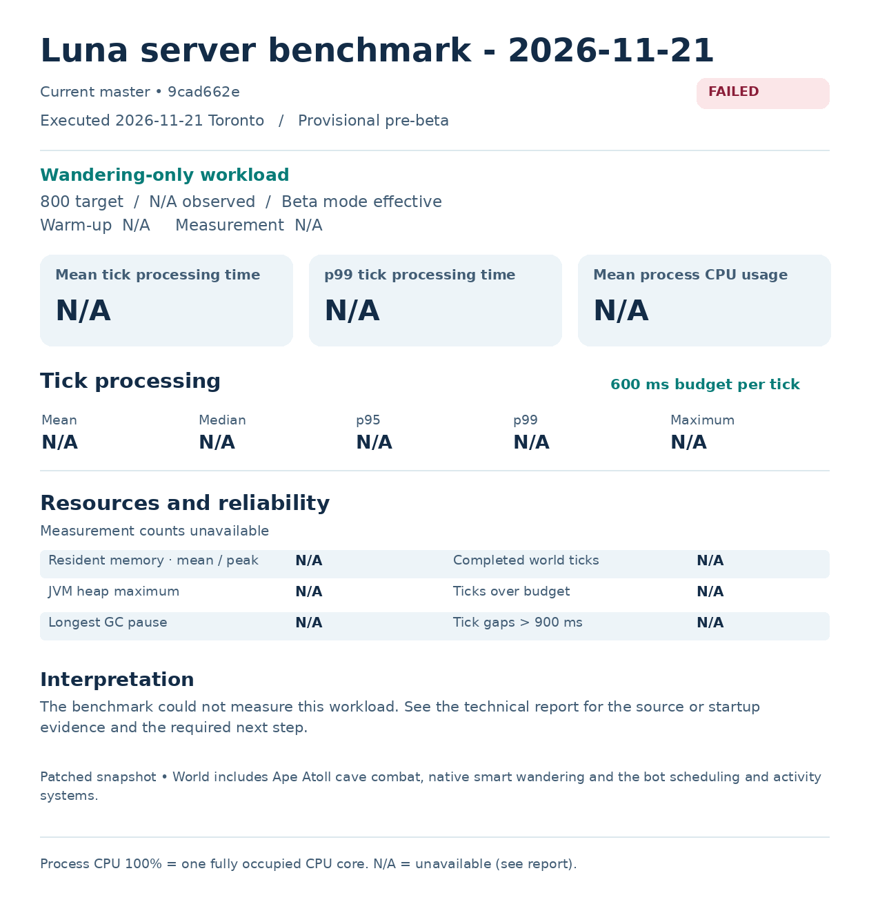

[Technical report](benchmark-2026-11-21-run-20261121T235521849932Z/report.md) · [Manifest](benchmark-2026-11-21-run-20261121T235521849932Z/manifest.json)

## 2026-11-21 · Current master · COMPLETE

Commit `9cad662e` · Attempt `20261121T235914749522Z`

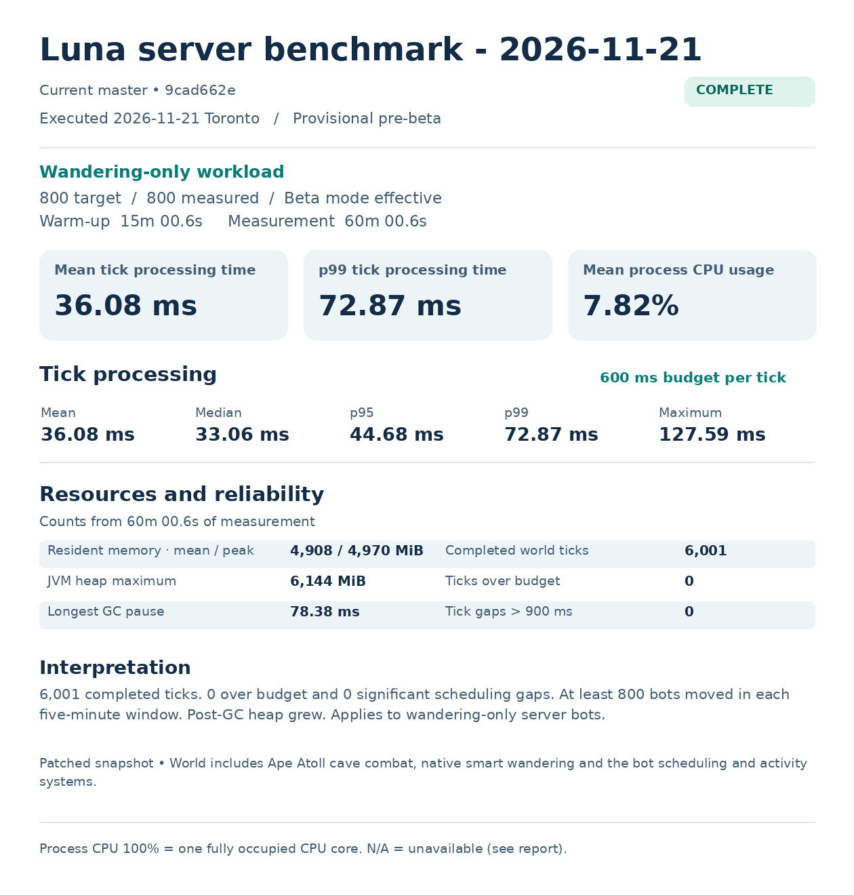

[Technical report](benchmark-2026-11-21-run-20261121T235914749522Z/report.md) · [Manifest](benchmark-2026-11-21-run-20261121T235914749522Z/manifest.json)
