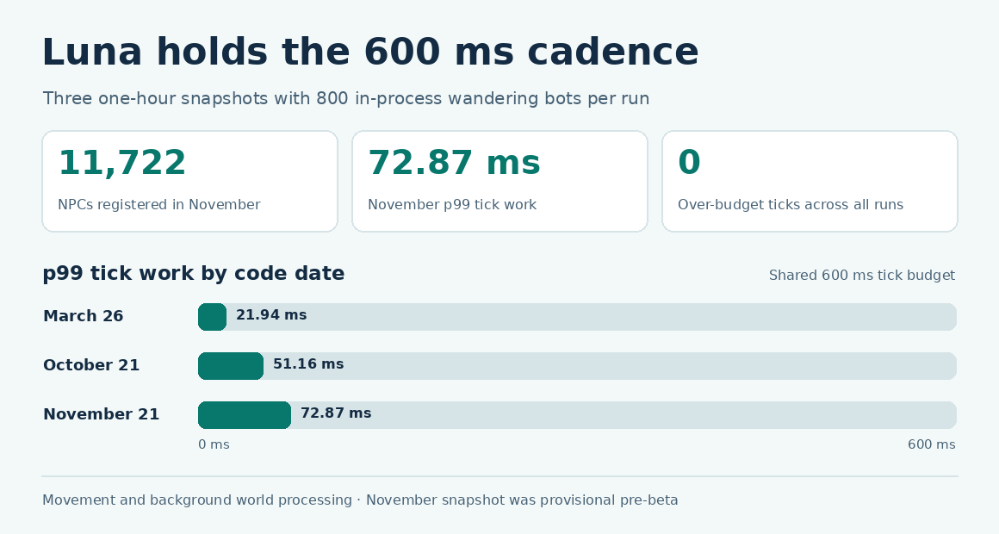

# Luna performance benchmarks

Three one-hour runs each sustained **800 in-process wandering bots** with ordinary background world processing.
All three recorded zero ticks over the 600 ms processing budget and zero scheduling gaps over 900 ms.
The November snapshot processed **6,001 ticks** with **11,722 registered NPCs**. Tick work took
**72.87 ms at p99**, about 12% of the tick budget, and peaked at **127.59 ms**.



## Results by code snapshot

| Snapshot | Registered NPCs | Mean tick work | p99 tick work | Mean process CPU | Mean resident memory | Evidence |
| --- | ---: | ---: | ---: | ---: | ---: | --- |
| Mar 26, 2026 · `c9552bea` | 52 | 7.31 ms | 21.94 ms | 194.07% | 5.76 GiB | [Run files](benchmark-2026-03-26-run-20261122T030608176775Z/) |
| Oct 21, 2026 · `a928f437` | 11,674 | 30.97 ms | 51.16 ms | 6.68% | 4.50 GiB | [Run files](benchmark-2026-10-21/) |
| Nov 21, 2026 · `9cad662e` | 11,722 | 36.08 ms | 72.87 ms | 7.82% | 4.79 GiB | [Run files](benchmark-2026-11-21-run-20261121T235914749522Z/) |

Tick work measures time spent in the scheduled game loop, and p99 is the 99th percentile across measured ticks.
Tick spacing measures elapsed time between starts. Process CPU includes worker threads and garbage collection,
with one fully occupied core counted as 100%. The runs used an allocation capped at four cores and 16 GiB.

## How performance changed

Between March and November, registered NPCs rose from 52 to 11,722 and tracked gameplay Kotlin files rose
from 278 to 1,265. The later snapshots include the Ape Atoll Agility Course, expanded Slayer encounters,
new shops and dialogue, and more elaborate Blast Furnace bot behavior.
[Content and engine history](https://github.com/luna-rs/luna/compare/c9552bea...9cad662e)

March averaged nearly two CPU cores and recorded about 80 seconds of GC pauses. November averaged 7.82% of one
core and recorded about three seconds of GC pauses. March used Java 11. October and November used Java 21.
The JVM, routefinder, and world population changed between snapshots.

From October to November, mean tick work rose by 5.11 ms, p99 rose by 21.70 ms, and mean resident memory rose
by about 305 MiB. All 800 bots moved during every rolling five-minute window in both runs. In November,
median post-GC heap use rose from 1,755 MiB in the first quarter to 2,080 MiB in the last quarter of the run.

## Workload and reproduction

Each run used native Luna bots that entered through the normal account login path. During measurement they
used Luna's smart wandering action and native pathfinder. Results cover bot movement and background world
processing. Networked player traffic, combat, skilling, and trade require separate workloads.

Each run directory holds a manifest with the exact revision and environment, the effective configuration,
the source patch, raw telemetry, a chart, and commands in `reproduce.txt`. From the repository root in the
benchmark environment, start a fresh run or replay the archived November source patch and configuration.

```sh
python3 scripts/performance/run.py run current
python3 scripts/performance/run.py replay data/benchmarks/benchmark-2026-11-21-run-20261121T235914749522Z
```

The harness verifies the revision 377 cache archive before use and uses the JDK and Gradle cache paths
recorded in the manifests. Chart rendering requires Pillow and DejaVu Sans.
[OpenRS2 cache 657](https://archive.openrs2.org/caches/runescape/657)

November is a provisional pre-beta snapshot. [Final beta checklist](https://github.com/luna-rs/luna/issues/581)
