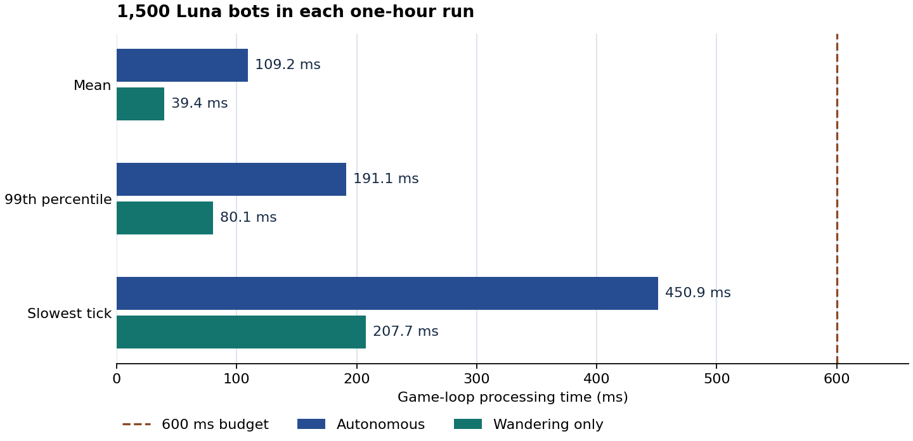

# Luna with 1,500 autonomous bots

Luna held **1,500 autonomous bots online for an hour** and completed all **6,001 world ticks** within its
600 ms processing budget. Tick work took **191.12 ms at p99**, about **32% of the budget**, and peaked at
450.91 ms. The bots fought, trained skills, shopped, and completed **101 trades** while tick starts at p99
were 600.23 ms apart. [Autonomous run summary](benchmark-2026-11-23-live-bots/live/summary.json)

## Performance compared with wandering

| Metric | 1,500 autonomous bots | 1,500 wandering bots | 800 wandering bots, Nov. 21 |
| --- | ---: | ---: | ---: |
| Completed world ticks | 6,001 | 6,001 | 6,001 |
| Mean tick work | 109.17 ms | 39.36 ms | 36.08 ms |
| p95 tick work | 160.24 ms | 53.46 ms | 44.68 ms |
| p99 tick work | 191.12 ms | 80.14 ms | 72.87 ms |
| Slowest tick | 450.91 ms | 207.66 ms | 127.59 ms |
| Ticks over 600 ms | 0 | 0 | 0 |
| Tick starts spaced over 900 ms | 0 | 0 | 0 |
| Mean process CPU | 114.77% | 11.31% | 7.82% |
| Mean resident memory | 4.53 GiB | 3.99 GiB | 4.79 GiB |
| Total GC pause time | 25.02 s | 3.36 s | 3.07 s |

Autonomy made mean tick work **2.77×** as expensive and used **10.15×** the process CPU of the matched
wandering run. Even with that extra work, Luna had about **409 ms of processing headroom at p99**.
That makes a strong case for Luna as a server for bot-populated worlds at this scale on comparable
hardware. [Matched wandering run](benchmark-2026-11-23-live-bots/wandering/summary.json)

Tick work measures time inside the scheduled game loop. Tick spacing measures time between consecutive
starts. Process CPU includes background workers and garbage collection, with 100% equal to one occupied
core. The November 21 run used 800 bots, an earlier revision, and development mode.
[November 21 run](benchmark-2026-11-21-run-20261121T235914749522Z/) · [Historical benchmarks](HISTORY.md)

## What the bots did

The autonomous cohort gained XP across **18 skills**, including Fishing, Mining, Cooking, Agility, and
combat skills. On an average tick **65 bots were in combat**, and **1,499 bots changed position** during
the hour. The script samples show NPC combat, Wilderness activity, trading, shop purchases, food
restocking, and skilling. [Activity and movement data](benchmark-2026-11-23-live-bots/live/raw/)

## Setup and reproduction

Both November 23 runs used revision `f5ae3775` in production mode on Linux with an AMD EPYC 9V74
processor, a four-core CPU quota, and 16 GiB of RAM. The JVM was Temurin 21.0.8 with G1 and a
6 GiB maximum heap. Each run started with fresh bot accounts and JSON saves, 11,722 registered NPCs,
and zero networked players. The driver supplied the login cohort to hold the population at 1,500,
using identical spawn tiles across 16 overworld areas. Each run had a 15-minute warm-up at full
population followed by one measured hour. The control used Luna's native smart wandering action.
[Tested revision](https://github.com/luna-rs/luna/commit/f5ae37757edddc3fa9e47996d9a3cdd231e29289)

The source patch, configuration, raw telemetry, and commands are archived with the run.
[Run files](benchmark-2026-11-23-live-bots/) · [Reproduce the benchmark](benchmark-2026-11-23-live-bots/reproduce.txt)
